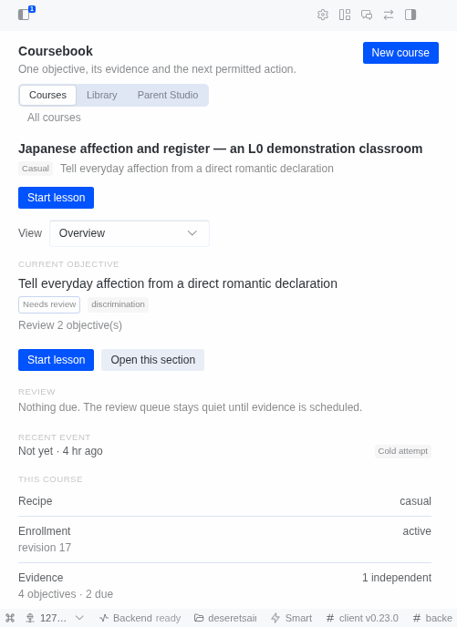

# Coursebook

**Coursebook is a Hermes Desktop learning workspace where a lesson is governed state, not chat:**
one objective at a time, typed checks, bounded grading, exactly one permitted transition per
committed answer, and an evidence row you can inspect, export and resume. It is for an adult
learning a real skill, and for a parent preparing a lesson pack that the parent then teaches:
children do not chat with Coursebook.



*Real capture from the pinned asset set at `1ba8ec6`, frame labelled in `docs/README-SHOTS.md`. The
Home surface has since been rebuilt as the Trailhead (H-176, `2b0324e`, branch
`wt/h176-trailhead-identity`, unmerged), so this README does not yet show today's Home; the
replacement frame set is open in `docs/STORY-GAPS.md`.*

## Install locally

```bash
# the repository is public; no credentials needed
git clone https://github.com/DeseretSaint/hermes-classroom && cd hermes-classroom
scripts/install-local.sh --home ~/.hermes/profiles/<your-profile>   # link, enable, verify
hermes gateway restart
```

Requirements: Hermes Agent 0.23.0 or newer, Python 3.11 or newer on the interpreter Hermes runs,
Node.js for `node --check` only. `--home` must be a profile or a disposable test home; the script
refuses the machine-level home on purpose. Full path, dependencies and the observed result:
`docs/INSTALL.md`.

## Three things this tree can be held to

Each is asserted by a test in the 2,724-test suite or by a state matrix run on this tree on
2026-11-08. None of them is a claim about learning outcomes, and none is a video.

1. **One answer, one transition.** `tests/test_kernel_transitions.py` (37 tests) asserts a pass
   commits exactly one transition, a duplicate nonce is ignored, an idempotency replay returns the
   persisted result, and two concurrent submits yield one commit and one `STALE_REVISION` — not two
   transitions.
2. **The answer key never leaves the backend.** `check.open` and `course.outline` carry
   `check_spec_withheld` in place of the reference, and `test_criteria_observations_never_contain_the_reference`
   covers the committed row. Re-run here: `python3 tests/adversarial/attack_state.py` →
   `SUMMARY total=23 fail=0 pass=23`, reference-leak scenarios included.
3. **An export is hash-verified.** `tests/test_course_export.py` re-hashes the zip bytes on disk and
   asserts they equal the artifact's declared `content_hash` ("never trust the writer"), and that
   the manifest carries teaching material rather than learner history.

## Status, 2026-11-10

The source repository is public and clones without credentials: `gh repo view
DeseretSaint/hermes-classroom` reports `"visibility": "PUBLIC"`, and an anonymous
`git ls-remote https://github.com/DeseretSaint/hermes-classroom.git refs/heads/master` resolves
`3278bae`. GitHub keeps no visibility-change timestamp for a user-owned repository, so this section
records when the public state was measured, not when it changed; the previous text here called the
repository private, and that is corrected rather than backdated.

A catalog entry exists and is submitted as a draft pull request: `plugin-catalog/coursebook.yaml` in
`NousResearch/hermes-agent#152920`, pinned to the commit `3278bae` on `master`, with
`docs_url` pointing at the `## Install locally` heading above. That pull request has not merged, so
the catalog `hermes-agent` ships still does not resolve `coursebook`; cloning is the install path
that works today. No release tag exists. **No demo video is recorded yet**: the demo gate
`t_6a32ffe9` is open because this host runs one gateway and no profile can yet drive chat and the
pane together; the 88-second shot list is ready and timed in `docs/HACKATHON-DEMO.md`. There is a
`LICENSE` file since 2026-11-10 (owner decision on `t_6f2d2080`, recorded as MIT in `LICENSE`).
Merging the catalog pull request, tagging and announcing stay closed under `docs/SUBMISSION.md` §0.
Everything below is the measured record, limitations included — the current candidate still has open
gates 7, 12, 13, 14 and 15, with 5 and 6 partial.

## Release record (0.1.0 and the product line)

Version 0.1.0. The release gates and the route evidence for the 0.1.0 tree are in
`docs/CB017-RELEASE-VERIFICATION.md` (CB-017 line, merged master `29bede7`); the adversarial
review and the contest matrix are `docs/REVIEW_CB017-FINAL.md`, including Vellum's row-9 export
tail in §10. `docs/CB016-RELEASE-VERIFICATION.md` is the earlier record at `e93b8c5`, kept for its
two condition captures. The adversarial report on the previous candidate is `docs/REVIEW_CB014.md`
(candidate `f4a42f34`, NO-GO on the Desktop route, not on the backend).

`master` has since advanced beyond `29bede7` with the M0 host-media slice (`3cead45`) and the
M1-M3 product line (`d28e7e3`). The 0.1.0 evidence above is still the `29bede7` record and has not
been re-run on the newer tree. The last frozen release tree is
`b9f4a197e42e4f033298d94608fcb5b63640b094` (the H-210-R2 merge over `df052ea`: the live pack round
trip that closed gate 4, plus its capture; the diff from `df052ea` is `docs/` and `audit/` only, and
the M4 audit is pinned to module `cd862140…c516`, which is unchanged on that tree). `master` has
advanced past it: the module at the head is `4087908c…`, and the audit committed at
`audit/visual/m4-visual/audit.json` was regenerated on 2026-11-10 for that module (15/15 claims PASS,
every measurement unchanged), so the committed audit names the module this tree ships; re-pinning
this record's module field to it is the remaining freeze step. The suite count and the
contract/schema rows in this README are measured on the `master` tree their row names; every other
pin and health row is the `b9f4a19` measurement, recorded in `docs/RELEASE-EVIDENCE.md`, with
`python3 scripts/check-docs-truth.py` failing when a document drifts from that record. It is not a
green release: the demo gate `t_6a32ffe9` is still open and no live Desktop window has driven this
tree; publication remains gated by `docs/SUBMISSION.md` §0.

### Product line after 0.1.0

This tree also carries the post-0.1.0 product line from `docs/VISUAL_MEDIA_PLAN.md`: M0 on `master`
at `3cead45`, M1-M3 merged on `master` at `d28e7e3`, and the M4 visual/accessibility/media evidence
regenerated on the settled H-209 tree `ab6dc7e` (H-208's union plus H-182/D8 and H-206), against
`desktop/plugin.js` sha256
`cd862140…c516` — reproducibility is
checked with `python3 scripts/m4v-repro-check.py`, which reports 62/62 identical screenshots and an
identical `audit.json` (modulo `generated_at`) on two consecutive runs at this pin; that output is
pasted in `docs/M4-VISUAL-MEDIA-AUDIT.md`. Phase-to-commit mapping, per-phase evidence and the gated
remainder: `docs/PRODUCT-LINE-RELEASE-NOTES.md`.

The 0.1.0 rows below are the release record for `29bede7` and are deliberately not rewritten to
describe this tree. The product-line rows are separate, and they use two weaker words:

- **Rendered** — the shipped Desktop module was mounted and measured in headless Chromium against a
  stub host transport. Real paint, real layout and a real accessibility tree; no backend, no chat,
  no `lesson.page` RPC.
- **Working (live)** — a mounted Desktop window reached a real isolated backend and the state was
  read back from it. Neither word means "recorded as a demo", and neither is a release claim.

| Product-line surface | State on this tree | Evidence |
| --- | --- | --- |
| Contracts `cb.rpc` v26 and `cb.db` v14, with `cb.jobs` v5, `cb.errors` v4 and the v1 `cb.pack`, `cb.projection` and `cb.vocabulary` | Working at this commit: 93 declared methods and 93 handlers. `observation.record` was frozen by `cb.rpc` v14 in H-53 and wired by H-54, so the registry test allows no gap: any declared method that loses its handler fails the suite. `cb.rpc` v26 is one additive amendment over v25 (CP-052: one optional `world_brief.route_anchors` array, no method moves); v25 is one additive amendment over v24 (CP-005: seven required `library_item` shelf facts — `sections_done`, `sections_total`, `checks_recorded`, `is_new`, `subject_label`, `cover_artifact_id`, `last_studied_at` — no method moves); v24 is additive over v23 and appends ten methods — GM-004's `world.read`, `world.style.preview`, `world.generate`, `world.approve` plus `course.mode.set`, GM-007's `homework.read`, `homework.create`, `homework.complete`, `homework.skip`, and GM-018's `takehome.html`; v23 added the Parent Studio take-home pack family (`takehome.sources`, `takehome.preview`, `takehome.create`, `takehome.approve`, `takehome.export`, `takehome.read`) whose artifact is bound to the source lesson version and content hash; v22 added GM-011's lesson-bound tutor (`tutor.ask`, `tutor.history`); v21 added GM-009's game-only engagement methods (`engagement.read`, `engagement.award`); v20 added the `parent.blueprint.read` `sections[]` identity a fine-tune call needs and the optional `validation` approval provenance a plan review reads before offering approval; v19 itself added the fine-tune commands (`plan.edit`, `plan.undo`, `lesson.revise`, `lesson.regenerate`, `parent.review.read`, `parent.final.approve`). Schema 14 from migrations `0001`-`0014` (v13 adds GM-001's Game Mode storage, v14 scopes a take-home pack's revision to the pack instead of its source slot) | `contracts/rpc.v26.json`, `contracts/db.v14.json`; parity asserted by the suite (`3523 tests OK (skipped=11)` on `master` `b1913af7`, the tree the suite measurement names; the 2880 of the previous record was measured on `3fb3779`); `coursebook/api.py` `implemented_methods()` returns all 93 declared methods |
| Textbook view | Working (live): a real document served over the real RPC; the frame set covers Textbook and Guided (13 frames) | `audit/visual/m1-guided-authoring/README.md` |
| Guided view | Working (live) on a newly authored document (`state=complete`, `views.guided=true`). The older demo course still reports `textbook_only` because its stored page predates `lesson-prompt.v5`; it was not rewritten | `audit/visual/m1-guided-authoring/` |
| Field Desk cockpit (Continue, path, stats, Field Notes, sources, all courses) | Working (live): the cockpit, its opened sources drawer, and its backend-off, empty and loading states were read from an isolated window at plugin sha `638e0f5e…` | `audit/visual/m2-field-desk/README.md`, `live-evidence.json` |
| Field Notes (save from a block, search, return to the exact block) | Working (live): 15 live frames including 460 px and exact-block return | `audit/visual/m2-field-notes/live-evidence.json` |
| Field Quest | Rendered: 14 static frames and 56 render/parity tests, plus a live availability capture. No live Quest frame exists, because the stored lessons in every reachable home predate authored `short` | `audit/visual/m2-field-quest/README.md`, `live-availability.json` |
| Procedure lens (typed header, numbered steps, hazard callout, schematic rows, source permission) | Authored and Rendered: the lesson schema and `lesson-prompt.v10` produce the typed `procedure` header, and `tests/test_procedure_authoring.py` drives the real lesson job with a fake model and asserts the served document renders the header, hazards, numbered steps, schematic rows and source card. The 7 visual frames and 28 validator/render tests remain fixture-based; no live provider run has authored one | `docs/M4-PROCEDURE-LAYOUT.md`, `docs/GENERATION.md`, `tests/test_procedure_authoring.py` |
| Pronunciation Studio (listen, record, compare, dispute) | Rendered: 14 frames and 15 jsdom interaction tests. It is inert on every existing section because none has a narration media child; no live attempt was walked | `docs/M3-PRONUNCIATION-UI.md`, `tests/test_desktop_pronunciation.py`, `audit/visual/m3-pronunciation/` |
| Media generation and preview | Working for the host adapter (one real PNG and one real MP3 through `docs/M0-MEDIA-PROBE.md`) and Rendered in the lesson (50 decoded images, 12 audio elements, 0 autoplay, text equivalent for each). The preview route is covered by tests, not driven live on this tree | `docs/M0-MEDIA-PROBE.md`, `docs/M4-VISUAL-MEDIA-AUDIT.md`, `audit/visual/m4-visual/audit.json` |
| M4 visual, contrast and accessibility gate | Rendered: 62 painted frames, 15/15 claims pass, 0 plugin-authored contrast failures over 2,120 text nodes (worst authored 5.93:1), 0 unnamed of 298 accessibility controls, no clipped text or horizontal overflow. Two consecutive `m4v-repro-check.py` runs at this module are identical: 62/62 screenshots and `audit.json` modulo `generated_at` | `audit/visual/m4-visual/audit.json` (the release-tree record is pinned to plugin `cd86214…` at `b9f4a19`, measured on `ab6dc7e`; the same file at this head is pinned to `4087908c…`, the module this tree ships, regenerated 2026-11-10 with every measurement reproduced), `docs/M4-VISUAL-MEDIA-AUDIT.md`, `scripts/m4v-repro-check.py` |
| 460 px narrow width | Partial: the module itself reflows at 460 px with no horizontal overflow, but the shipped host still gives the route 101 px when the chat rail is docked. The host patch that fixes the grid is neither merged nor installed | `audit/visual/m1-narrow-width/DECISION.md` §Residuals; `audit/visual/m4-visual/*-460-*.png` |

Nothing in the product line changes install status. The catalog entry pins the release candidate and
is open as a draft pull request, and no release tag exists.

### 0.1.0 surface table (release record, post-release changes named)

Three states are used in this table. **Working** means a command was run against that build and
passed.
**Implemented, unverified in the UI** means the backend path is implemented and tested, and the
Desktop surface exists, but this release pass did not drive it through the UI. **Absent** means
there is no code path at all. Unless a row names a later commit, the row describes `29bede7`.

| Surface | State in this build |
| --- | --- |
| One installable package (agent half plus Desktop half) | Working: `scripts/install-local.sh` installs both halves; `hermes plugins validate` and `hermes plugins doctor` pass |
| `coursebook_status` agent tool (read-only health) | Working: one of the two registered tools |
| `coursebook_due` agent tool (read-only next step) | Working: reads the same profile-scoped store as the Desktop (`library.list` next step plus the derived `review.queue`). Writes nothing, makes no provider call, and reports an unavailable database as `available:false` with a reason instead of an empty list |
| Backend routes `/health`, `/schema`, `/rpc`, `/runtime`, `/packs/*`, `/artifacts/<handle>`, `/media/<artifact_id>` | Implemented: the first six were re-driven by `scripts/probe-backend.py` (31/31). `/media/<artifact_id>` is an M0 addition (`3cead45`), covered by `tests/test_manifest.py` and `tests/test_media_generation.py`; it does not exist at `29bede7` |
| Frozen contracts at `29bede7`: `cb.rpc` v7, `cb.db` v4, `cb.jobs` v2, `cb.errors` v2, `cb.pack` v1, `cb.projection` v1, `cb.vocabulary` v1 | Working in that build: 52 declared methods, 52 handlers, no contract problems from `/runtime`. This tree has moved to `cb.rpc` v25 and `cb.db` v14 with 93 declared methods and 93 handlers; the product-line row above carries the current numbers |
| Profile-scoped SQLite schema and migrations `0001`-`0004` at `29bede7` | Working: `health.get` answers `db.ready: true`, `schema_version: 4` on a fresh home. This tree ships migrations `0001`-`0014` and answers `db.ready: true`, `schema_version: 14` on a fresh home |
| Desktop route `#/coursebook`, sidebar entry, pane, command palette, settings page | Working with a reachable backend: mounts the library, `New course`, Parent Studio and a course card (`docs/CB017-RELEASE-VERIFICATION.md` §2). A window with no gateway renders no route page for any hash — host shell degradation, reclassified P3-operational by Atlas (`docs/REVIEW_CB017-FINAL.md` §3.1) |
| Desktop keybinds `coursebook.focus` (`Mod+Shift+K`) and `coursebook.tutor` (`Mod+J`) | Registered through `KEYBINDS_AREA`, rebindable defaults, never synthetic key events: `coursebook.focus` opens `#/coursebook`; `coursebook.tutor` (GM-012 §7.3) fronts the tutor rail and puts the caret in its composer — navigation only, it never sends the draft |
| Course creation, plans, lessons, grading, transitions, evidence | Implemented, unverified in the UI: 685-test suite at `29bede7`, plus adversarial S01/S02/S10-S12 (duplicate submit, stale revision, invalid/hung/throwing grader) all pass in that build. The suite measured 2724 tests at `ab6dc7e` |
| Replan of an approved plan, then lessons, then export | Working end to end for this tree: replan → plan approve (v10) → lessons job start → 4 lessons authored → lesson-set approve → export, with the UI and the backend agreeing on the approved content hash (`sha256:ccf69462…e5a5`), `export.ready: true` and no `blocked_reason`. Evidence: `docs/REVIEW_CB017-row9-ui.json`, `docs/REVIEW_CB017-FINAL.md` §10 |
| Notebooks, quiz history, review queue, usage accounting | Implemented, unverified in the UI: `notebook.save/list/update/delete`, `quiz.history`, `review.queue/action` and `usage.summary` are in the mounted registry |
| Pack import and export, Parent Studio authoring | Implemented, unverified in the UI: `pack.import/export/preview/inspect/list/delete` and eight `parent.*` methods; P17/P18/P20 pass, and export reproduces the reviewed content hash |
| Research | Implemented inside plan jobs: bounded, query-capped and ledgered through the host `web_search`/`web_extract` seam; records `unavailable` rather than inventing a source. No standalone RPC |
| Image and speech generation | Implemented on `master` since `3cead45` (M0): the host's configured image/TTS providers are called through `ctx.dispatch_tool`; generated visuals and narration are stored as content-addressed artifacts with text equivalents and honest degraded states. Absent at the 0.1.0 release commit `29bede7`. Pronunciation scoring is not shipped yet |
| Reminders | Absent: no RPC, no job runner, no storage |

Every method declared by `cb.rpc` v7 had a handler in the `29bede7` build. On this tree all 93 of
`cb.rpc` v26's declared methods have handlers, `observation.record` included — frozen by H-53 and
wired by H-54, with the H-53→H-54 registry allowance removed. The count comes from
`coursebook/api.py`'s `implemented_methods()` after importing every registering module
(`coursebook.domain`, `coursebook.engagement`, `coursebook.pack_flow`, `coursebook.pronunciation`,
`coursebook.syllabus`, `coursebook.tutor`, `coursebook.world`), not from a text search, and
`tests/test_kernel_v2.py` asserts the registry covers every declared method. So there is no command that answers a plausible success for work it cannot do. A method
outside the contract is refused with `VALIDATION_FAILED`; a declared method with no handler answers
`NOT_IMPLEMENTED`; a handler that cannot answer returns a contract error rather than a fabricated
result. `evidence.inspect` no longer carries an open check's reference answer: criteria
are projected through `PUBLIC_CRITERION_FIELDS` with a `check_spec_withheld` marker, so the
`check_spec` that holds the reference never leaves the backend. That closes CB-QA-10 on the wire
(`docs/HARNESS-STATUS.md` §4; S07 passes in `tests/adversarial/attack_state.py`). One backend
defect remains open and is recorded in `docs/REVIEW_CB014.md`: the optional auxiliary grader cannot
yet distinguish a persuaded pass from an honest one (CB-QA-11).

## Requirements

- Hermes Agent 0.23.0 or newer, with the Desktop app.
- Python 3.11 or newer (the repository tests run on the interpreter Hermes ships).
- Node.js, only for the `node --check` syntax gate. The plugin itself needs no build step.

## Install from a local checkout

These commands were run against this checkout before they were written down. Run them from the
repository root.

```
bash scripts/install-dev.sh
hermes plugins enable coursebook
hermes gateway restart
```

`scripts/install-dev.sh` symlinks this checkout into `$HERMES_HOME/plugins/coursebook` and prints
the next steps. It refuses to replace a real directory and refuses to run outside a Coursebook
checkout. It does not enable anything.

`scripts/install-local.sh` is the scripted equivalent: it installs both halves into one dedicated
home, enables the plugin, and verifies the install with `hermes plugins validate` and
`hermes plugins doctor`.

Then enable the Desktop half in the app: Capabilities, Plugins, Coursebook, on. The two halves
are enabled separately; the pane detects the mismatch and says so.

Verify:

```
hermes plugins doctor coursebook
bash scripts/validate.sh
```

Cloning from GitHub is the supported install path today: the repository is public, and the clone
in `## Install locally` above is the path the catalog entry's `docs_url` points at.

```
hermes plugins install https://github.com/DeseretSaint/hermes-classroom \
  --ref 172b61aaffd44c33f2c89360df9f1fceeff66c37 --yes-deps --enable
```

The install-time scanner returns a **caution** verdict for this repository because it scans the
committed test fixtures and audit captures along with the plugin code (1,183 findings, almost all
LOW). It prints the report and refuses without a human decision, which a Desktop install cannot
give. Read the report, then repeat the command with `--force`. A catalog install (`hermes plugins
install coursebook`) does not need `--force`: a curated pin accepts caution without a prompt.

`hermes plugins install coursebook` — the catalog path — does not work yet. The entry is submitted as
`plugin-catalog/coursebook.yaml` in `NousResearch/hermes-agent#152920`, an open draft pull request,
and the catalog `hermes-agent` ships does not resolve `coursebook` until that merges. The entry now
pins `172b61aa` on `master` (the CP-015g portability build) and validates under `hermes-agent`'s
pinned-source catalog gate: the CP-039 review ran that gate at the previous pin and it exited 0,
16/16 checks, including the symlink-confinement check that rejected the pin before it. Gates 7 and
12 of `docs/SUBMISSION.md` (demo scenarios, catalog merge) are open, so the pull request stays
draft. Owner: Harbor and DeseretSaint.

## First run

Open Coursebook in the Desktop sidebar. The plugin loads: the sidebar item, the pane and the
command-palette entries register, and the settings page registers when the host exposes a
settings-page seam. With no chat bound to an enrollment, the pane offers `Open Coursebook` and
reports that no durable chat is bound yet. The backend it reads answers `health.get` with
`db.ready: true` and `schema_version: 14`.

In a window that reaches a gateway-backed backend, `#/coursebook` mounts the course library, the
`New course` action and Parent Studio (`docs/CB017-RELEASE-VERIFICATION.md` §2). A window whose
isolated home has no gateway shows the session home for every hash instead — that is the shell,
not the plugin, and Atlas reclassified CB-QA-09 as P3-operational on exactly that evidence
(`docs/REVIEW_CB017-FINAL.md` §3.1). A demo that shows the chat side still needs a composer, which
means recording on the profile that owns this host's gateway.

Ask the agent to run `coursebook_status` to get the health block as JSON, or `coursebook_due` to
get the learner's next step from this profile's local store. If the backend is not
mounted, the pane names the enable path and offers Check again instead of showing an empty
course list.

Step-by-step install, uninstall and troubleshooting: `docs/INSTALL.md`.

## Privacy and egress

Coursebook holds no vendor credentials and reads no provider key. Provider calls go through a
seam the Hermes profile already configures:

- lesson chat uses the selected chat provider and any configured external memory provider;
- plan and lesson generation use the host plugin LLM route; the optional auxiliary grader uses
  the same route and is disabled in this build;
- research uses the host `web_search` and `web_extract` tools, so the user's configured backend,
  egress rules and SSRF checks apply;
- pack import and export are local files and perform no upload, and there is no telemetry.

Two operations do make a direct outbound HTTP request of Coursebook's own, both outside that seam:

- **Provider image download.** When the host binds `ctx.dispatch_tool` and `image_generate`
  returns an artifact URL, Coursebook downloads the bytes itself from an allowlisted
  `*.fal.media` / `*.fal.run` host (`coursebook/media.py`). The URL is the provider's own
  artifact URL, never one supplied by the model or a learner; the redirect target is re-checked
  against the same allowlist, and a provider or download failure degrades to the text equivalent.
- **First-use speech-model download.** The first pronunciation attempt with an empty cache
  downloads `faster-whisper` model weights from Hugging Face into `<plugin data>/stt-models`
  (`coursebook/stt.py`). Weights only: no audio or learner data is sent, and the take is deleted
  after local scoring.

Neither request carries a schoolwork payload, and neither uses a credential Coursebook holds.

State lives in profile-scoped SQLite at `$HERMES_HOME/plugin-data/coursebook/data.db` and
migrates on first use, through migrations `0001`-`0014` (schema v14) on this tree. Usage rows are
recorded locally, and only for a session this process observed as bound to an enrollment. "Local"
describes storage, not inference.

Full text, including what Coursebook refuses to do with schoolwork and what it cannot control at
the host level: `docs/PRIVACY_EGRESS.md`.

## Limitations

This candidate is not shippable as a Desktop product.

- CB-QA-09 is a host gateway binding, not a plugin defect (P3-operational, Atlas ruling in
  `docs/REVIEW_CB017-FINAL.md` §3.1). This host runs one gateway for profile `default` and refuses
  a second, so an isolated window has no composer; the plugin's own `Backend off` / `Offline`
  states are proven separately. The demo's chat surface therefore needs the operator to record on
  the gateway-owning profile, or to stop that gateway first.
- Row 9 is closed on this tree (replan → lessons → export, §"Status"); the demo still cannot be
  recorded on this host for the gateway reason above, and that is a process blocker, not a product
  one.
- Image and speech generation now use the host's configured providers through the plugin seam;
  pronunciation scoring and reminders remain absent.
- The auxiliary open-response grader is disabled. Closed checks are graded against a stored
  reference; with the lane enabled, an answer that persuades an obedient grader is accepted
  (CB-QA-11).
- `evidence.inspect` withholds an open check's reference on the wire (CB-QA-10 closed). The L2
  projection carries `id`, `description`, `check_id` and a `check_spec_withheld` marker from
  `coursebook/evidence.py`'s `PUBLIC_CRITERION_FIELDS`, so the spec that holds the reference never
  reaches the caller; `tests/test_review_evidence.py:378,384` assert its absence and S07 passes;
  the state matrix on this candidate is `SUMMARY total=23 fail=0 pass=23` with S13 `BLOCKED`
  (auxiliary grader lane disabled).

The product line adds surfaces with limits of their own; these are not the 0.1.0 rows above.

- Narrow width is a host gap, not a plugin claim. At 460 px the shipped host gives the Coursebook
  route 101 px while the chat rail is docked. The fix (`narrowLeavesGrid`) lives on
  `DeseretSaint/hermes-agent` branch `wt/host-narrow-rail` (`5900b6e7a0`), is neither merged nor
  installed, and the M4 frames measure the module in a 460 px viewport rather than through the host
  grid (`audit/visual/m1-narrow-width/DECISION.md`).
- Field Quest has no live frame. Stored lessons predate authored `short`, so `views.field_quest` is
  false on every section a window reached; the lens is proven by render and parity tests
  (`audit/visual/m2-field-quest/README.md`).
- The procedure lens has no authoring path. The validator, contract and renderer are proven against
  a contract-valid fixture; the lesson prompt does not emit `procedure` yet
  (`docs/M4-PROCEDURE-LAYOUT.md`).
- The Pronunciation Studio is inert until a section carries narration media, and no existing section
  does. With no recogniser configured it says "Practice only, not graded" and records nothing; a
  take is `model_assessed` evidence, never verified pronunciation or mastery
  (`docs/M3-PRONUNCIATION-UI.md`).
- Media proof is split. Generation is real (one host PNG and one host MP3 in
  `docs/M0-MEDIA-PROBE.md`); the lesson renderer is measured statically, and audio is checked for
  attributes and decode, not audibility (`docs/M4-VISUAL-MEDIA-AUDIT.md`).
- No user-facing text-only or reduced-data preference ships. The text-only path exercised is the
  no-artifact fallback.
- Reduced motion is measured, not vacuous: H-152 ships real transitions, so the four reduced-motion
  frames paint 0 animated nodes while the full-motion frames paint 70; the preference suppresses the
  motion rather than there being none to suppress.
- Accessibility names come from the Chromium accessibility tree, not from a screen reader.
- A failed audio preview is typed `visual` in the internal `data-cb-media-kind` attribute while its
  visible label and transcript stay correct (`t_acd97416`, low, open).
- The product line is not demo evidence and not a release: no video exists, the demo gate is NOT
  MET (`docs/DEMO.md`), the catalog pull request is open and draft and has not merged, and no tag or
  contest submission was made (`docs/SUBMISSION.md` §0).

There is no learning-style diagnosis, no "2 sigma" claim, no guaranteed mastery, no child safety
or COPPA certification, and no efficacy claim. Educational research motivates the design;
Coursebook has not established that it improves learning. Parent observations are labeled
`parent_reported` and are never combined with automated mastery.

## Documentation

- `docs/INSTALL.md`: install, enable, verify, uninstall, troubleshooting.
- `docs/ARCHITECTURE.md`: verified SDK seams, spec to SDK corrections, failure states, and the
  stored-lesson-text repair marker.
- `docs/CONTRACTS.md`: the seven frozen contracts and their open questions.
- `docs/GENERATION.md`: the plan and lesson pipeline, research ledger and validation pass.
- `docs/WORK_PACKAGES.md`: file ownership and merge order.
- `docs/PRIVACY_EGRESS.md`: per-operation disclosure.
- `docs/DEMO.md`: the demo script and its precomputed/live split.
- `docs/PRODUCT-LINE-RELEASE-NOTES.md`: phase-to-commit map for the post-0.1.0 product line and what
  is still gated.
- `docs/VISUAL_MEDIA_PLAN.md`: the product-line direction that M0-M4 implement.
- `docs/M0-MEDIA-PROBE.md`, `docs/M4-VISUAL-MEDIA-AUDIT.md`, `docs/M4-PROCEDURE-LAYOUT.md`,
  `docs/M3-PRONUNCIATION-UI.md`: measured evidence for media, the visual/a11y gate, the procedure
  lens and the pronunciation studio.
- `docs/CB017-RELEASE-VERIFICATION.md`: gates, clean install, the clean-export run and the route
  finding as reclassified (CB-017 line, merged master `29bede7`).
- `docs/CB016-RELEASE-VERIFICATION.md`: the earlier record at `e93b8c5`, including the two route
  condition captures.
- `CHANGELOG.md`: what 0.1.0 contains and what it does not.
- `docs/SUBMISSION.md`: submission checklist, owners and gates.
- `docs/REVIEW_CB014.md`: the release-gate report on this candidate.
- `PREBUILD_SPEC.md`, `UX_SPEC.md`, `PLAN.md`: the frozen design, interface contract and plan.
- `AUDIT.md`: adversarial audit, including the product and demo corrections.
- `VAULT_LEARNING.md`: research leads behind the design.

## Development

```
bash scripts/test.sh            # unit tests, then node --check desktop/plugin.js
bash scripts/validate.sh        # pre-merge gate: tests, syntax, admission on an export, doctor, probe
bash scripts/validate-plugin.sh # release gate: admission on a git archive export of HEAD
```

Run `scripts/validate.sh` before any merge into master. It is the pre-merge gate; it passed on the
0.1.0 commit with 685 tests, node check OK and 31/31 backend expectations. The suite measured
2724 tests at `ab6dc7e` (`python3 -m unittest discover -s tests -t .`, `Ran 2724 tests in 533.270s`,
`OK`). Its admission step validates
an export of the tracked tree (`scripts/lib/gate-export.sh`), not the checkout root, so the
gitignored `.worktrees/` farm is never scanned and an uncommitted edit to a tracked file still fails
that step. `scripts/validate-plugin.sh` is the release gate for one pinned commit.

`desktop/plugin.js` is a single ES module with no relative imports and no JSX, because the
Desktop runtime loader refuses everything else. It is a single-writer file; see
`docs/WORK_PACKAGES.md`.

## License

MIT. The terms are in `LICENSE` at the repository root, copyright 2026 DeseretSaint. The owner chose
MIT on 2026-11-10 in board card `t_6f2d2080`; that card's docs follow-through (this section, gate 9
in `docs/SUBMISSION.md`, `CHANGELOG.md` and the catalog's `known_issues`) lands in the same commit.
Publication — merging the catalog pull request, tagging, announcing — stays closed under
`docs/SUBMISSION.md` §0: a license makes redistribution lawful and a public repository makes the
source clonable, and neither authorises announcing the release.
